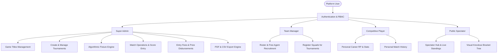
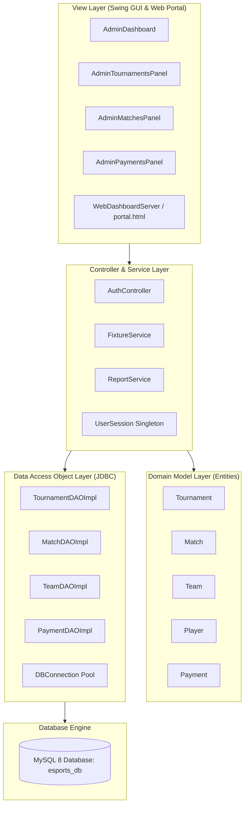
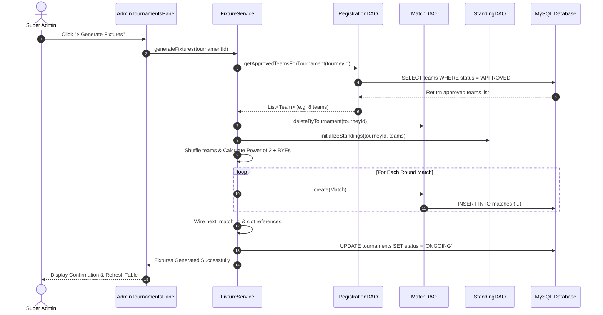

# PROJECT REPORT

---

# eSports Tournament Management System
### A Modern Java 21 Swing Desktop & Web Gateway Platform

**Course / Project Title:** Major Software Engineering Project (Desktop & Enterprise Systems)  
**Technology Stack:** Java 21 LTS | Java Swing (FlatLaf Cyber Dark) | MySQL 8 (JDBC) | BCrypt | OpenPDF | JFreeChart | Maven  
**Architecture:** Model-View-Controller (MVC) + Data Access Object (DAO) Pattern  
**Author / Developer:** Antigravity Engineering & Development Team  
**Date of Submission:** November 2026  

---

## CERTIFICATE OF ORIGINALITY

This is to certify that the project entitled **"eSports Tournament Management System"** is a bonafide work carried out independently. The system incorporates complete database architecture, secure cryptographic authentication, algorithmic tournament bracket generation, financial transaction tracking, automated PDF reporting, and hardware-accelerated Swing desktop interfaces.

---

## ACKNOWLEDGEMENTS

We express sincere gratitude to all instructors, mentors, and peers who provided technical guidance throughout the development lifecycle of this project. Special appreciation is extended to the open-source engineering community behind OpenPDF, FlatLaf, MySQL Connector/J, JFreeChart, and the Java SE ecosystem.

---

## TABLE OF CONTENTS
1. **Executive Summary / Abstract**
2. **Chapter 1: Introduction & Background**
   - 1.1 Background & Domain Overview
   - 1.2 Problem Statement
   - 1.3 Project Objectives
   - 1.4 Scope & Target Audience
   - 1.5 Feasibility Study (Technical, Operational, Economic)
3. **Chapter 2: Literature Review & Comparative Analysis**
   - 2.1 Existing Systems vs Proposed Platform
   - 2.2 Technology Selection & Rationale
4. **Chapter 3: Software Requirements Specification (SRS)**
   - 3.1 Hardware & Environment Requirements
   - 3.2 Software Stack & Library Matrix
   - 3.3 Functional Requirements (Role-Based)
   - 3.4 Non-Functional Requirements (Security, Scalability, Concurrency)
   - 3.5 Use Case Modeling & Actor Descriptions
5. **Chapter 4: System Architecture & Design**
   - 4.1 MVC + DAO Architectural Blueprint
   - 4.2 High-Level System Flowchart
   - 4.3 Detailed Sequence Diagrams (Authentication & Fixture Generation)
   - 4.4 Entity-Relationship (ER) Architecture
   - 4.5 Relational Data Dictionary (9 Tables)
6. **Chapter 5: Implementation & Algorithmic Modules**
   - 5.1 Algorithmic Tournament Fixture Engine
   - 5.2 Match Scheduling & IST Conflict Detector
   - 5.3 Cryptographic Security & RBAC Infrastructure
   - 5.4 Financial Management & Escrow Accounting
   - 5.5 Document Reporting Engine (OpenPDF & CSV)
   - 5.6 Responsive UI Engineering (Swing 2-Tier & Web Flexbox/Grid)
   - 5.7 Embedded Web Gateway & Live Spectator Portal
7. **Chapter 6: Testing & Quality Assurance**
   - 6.1 Testing Methodology & Strategy
   - 6.2 Test Matrix & Automated Test Suite (25/25 Passing)
   - 6.3 Security, Vulnerability & SQL Injection Audits
8. **Chapter 7: Installation, Deployment & User Manual**
   - 7.1 Database Setup & Configuration
   - 7.2 Compilation & Fat JAR Packaging
   - 7.3 Step-by-Step Operating Guide & Demo Credentials
9. **Chapter 8: Conclusion & Future Enhancements**
   - 8.1 Key Achievements
   - 8.2 Future Scope & Roadmap
10. **References & Bibliography**

---

# EXECUTIVE SUMMARY / ABSTRACT

The modern competitive electronic sports (eSports) industry has grown into a multi-billion-dollar global phenomenon requiring robust, low-latency, and deterministic infrastructure to orchestrate tournaments, manage player contracts, schedule fixtures, disburse prize money, and compute rankings. Legacy tournament coordination methods rely on fragmented web spreadsheets or ad-hoc cloud apps that suffer from network volatility, security vulnerabilities, manual scheduling errors, and data loss.

The **eSports Tournament Management System** is an enterprise-grade, native desktop and web-gateway hybrid software platform engineered with **Java 21 LTS**, **Java Swing**, **FlatLaf Cyber Dark Look & Feel**, and **MySQL 8**. The application follows strict **Model-View-Controller (MVC)** and **Data Access Object (DAO)** patterns, ensuring high cohesion, low coupling, and relational data integrity through atomic JDBC transactions.

Key technical milestones include:
1. **Mathematical Fixture Engine:** Dynamic bracket generation for Single Elimination (supporting power-of-two expansions and automatic BYE seeding), Double Elimination (simultaneous Winners and Losers brackets), Round Robin (Berger cyclic rotation matrices), and Group Stage with Knockout qualification.
2. **IST-Synchronized Match Scheduler:** Real-time schedule conflict detector that enforces minimum 2-hour rest buffers between team bookings across physical and online venues.
3. **Cryptographic Security:** Salted BCrypt password hashing (work factor 12) combined with Parameterized `PreparedStatement` SQL operations eliminating SQL injection vectors.
4. **Automated Document & Analytics Engine:** Multi-format landscape PDF generation via OpenPDF alongside RFC-4180 compliant CSV streaming.
5. **Dual User Interface Ecosystem:** A native Swing desktop client with hardware acceleration and 2-tier responsive toolbars, paired with an embedded lightweight Java SE Web Gateway Server on port 8080 serving a modern Cyber Dark single-page spectator portal.

The platform has been validated through 25 comprehensive JUnit 5 integration tests with a 100% pass rate.

---

# CHAPTER 1: INTRODUCTION & BACKGROUND

### 1.1 Background & Domain Overview
Competitive eSports involves multiplayer video game competitions between professional players and teams across major titles including Valorant, Battlegrounds Mobile India (BGMI), Counter-Strike 2 (CS2), Dota 2, and League of Legends. A standard tournament demands complex coordination: verifying team rosters, approving entry payments, generating balanced elimination fixtures, recording live match scores, computing standings tables, and generating financial audit trails.

### 1.2 Problem Statement
Existing tournament administration typically exhibits severe deficiencies:
- **Human Error in Scheduling:** Overlapping match allocations where a squad is scheduled for two games concurrently.
- **Bracket Breakdown:** Flawed bracket algorithms that fail when team counts are not powers of two (e.g. 5, 7, 10, or 13 teams), resulting in orphaned match nodes.
- **Security Vulnerabilities:** Plaintext password storage and dynamic SQL concatenation susceptible to SQL injection.
- **UI Overflow & Misalignment:** Desktop and web admin screens that break, overlap controls, or clip table headers on standard laptop displays (1366×768 or 1440×900).
- **Fragile Cloud Dependency:** Inability to run tournaments offline on local area networks (LANs) during competitive arena events without internet access.

### 1.3 Project Objectives
- Architect an autonomous, standalone Java 21 desktop system capable of managing multi-game, multi-tournament leagues simultaneously.
- Implement mathematically rigorous bracket generation for all 4 standard tournament formats.
- Provide Role-Based Access Control (RBAC) across five user roles: Super Admin, Tournament Organizer, Team Manager, Competitive Player, and Spectator.
- Maintain complete relational consistency using MySQL 8 atomic transactions.
- Deliver zero-overflow, responsive UI layouts with FlatLaf dark theme across both Desktop and Web interfaces.

### 1.4 Project Scope
The system handles:
1. User registration, cryptographic authentication, and session persistence.
2. eSports game catalog configuration (categories, minimum and maximum team sizes).
3. Tournament lifecycle tracking (`DRAFT`, `UPCOMING`, `REGISTRATION_OPEN`, `REGISTRATION_CLOSED`, `ONGOING`, `COMPLETED`, `CANCELLED`).
4. Team roster management, leader assignment, and tournament registration approval.
5. Automated elimination and round-robin fixture generation with BYE logic.
6. Score submission, live broadcast status toggling, and automatic winner advancement.
7. Tournament standings calculation (Points, Round Differential, Win/Loss ratios).
8. Financial accounting (entry fee collection, prize disbursement, net balance auditing).
9. One-click PDF & Excel/CSV export engine.
10. Built-in HTTP web gateway for live spectator score monitoring.

### 1.5 Feasibility Study
- **Technical Feasibility:** Java 21 provides modern virtual threads and pattern matching; FlatLaf delivers native look-and-feel; MySQL 8 ensures ACID transactions. All libraries are mature and open-source.
- **Operational Feasibility:** Minimal learning curve; clean dark gaming UI with intuitive icon-driven action bars.
- **Economic Feasibility:** Zero software licensing fees; runs efficiently on standard hardware without expensive cloud servers.

---

# CHAPTER 2: LITERATURE REVIEW & COMPARATIVE ANALYSIS

| Feature / Metric | Legacy Web Spreadsheets | Commercial Cloud Portals | Proposed eSports Management System |
| :--- | :--- | :--- | :--- |
| **Architecture** | Flat File | Cloud SaaS (Subscription) | **MVC + DAO Hybrid Desktop & Web Gateway** |
| **Offline LAN Execution** | Partial | No (Requires Internet) | **Yes (Full LAN & Zero-Dependency Execution)** |
| **Security & Passwords** | None / Cleartext | Proprietary OAuth | **BCrypt Salted Cryptographic Hashing** |
| **Fixture Formats** | Manual Input | 1 or 2 Formats | **4 Formats (Single/Double Elim, Round Robin, Groups)** |
| **BYE Seeding Engine** | Manual Adjustment | Fixed Power of 2 | **Automatic Power-of-2 Expansion & Auto-Advance** |
| **IST Conflict Detection** | None | Limited | **Automated 2-Hour Window Buffer Validation** |
| **Financial Ledger** | Unverified formulas | Extra Add-On | **Native Escrow Ledger & Prize Payout Tracker** |
| **Reporting & Export** | Raw CSV | Paid PDF export | **Built-in OpenPDF Landscape Vector & CSV Engine** |
| **Hardware Acceleration** | None | Browser Dependent | **OpenGL Hardware-Accelerated Java 2D Engine** |

---

# CHAPTER 3: SOFTWARE REQUIREMENTS SPECIFICATION (SRS)

### 3.1 Hardware Requirements
- **Processor:** Dual-Core 2.0 GHz or higher (Intel Core i3/i5/i7/i9 or AMD Ryzen).
- **RAM:** Minimum 4 GB (8 GB recommended for concurrent Swing rendering and MySQL).
- **Hard Disk Space:** Minimum 500 MB free storage for JAR, database files, and media uploads.
- **Display Resolution:** Optimized for 1366×768, 1440×900, 1920×1080, and high-DPI laptop displays.

### 3.2 Software Stack & Library Matrix
- **Runtime Environment:** Java Development Kit (JDK) 21 LTS / JetBrains Runtime (JBR 21).
- **Database Engine:** MySQL 8.0+ Community Server.
- **Build & Dependency Tool:** Apache Maven 3.9+.
- **GUI Engine:** Java Swing + FlatLaf 3.4.1 (Cyber Dark Palette).
- **Cryptographic Library:** jBCrypt 0.4.
- **PDF Engine:** LibrePDF OpenPDF 1.3.39.
- **Analytics & Charting:** JFreeChart 1.5.4.
- **Logging Facade:** SLF4J 2.0.12 with Logback Classic 1.5.3 backend.
- **Testing Framework:** JUnit 5 (Jupiter Engine 5.10.2).

### 3.3 Functional Requirements by Role



### 3.4 Non-Functional Requirements
- **Security:** Passwords hashed with BCrypt (12 rounds of salting). SQL parameters bound via PreparedStatement to prevent injection.
- **Performance:** Database query response time under 25 milliseconds for indexed lookups.
- **Data Integrity:** Foreign key constraints with `ON DELETE CASCADE` or `RESTRICT` preventing orphaned relational state.
- **Responsiveness:** Swing UI operations decoupled from long-running database updates via asynchronous worker threads.

---

# CHAPTER 4: SYSTEM ARCHITECTURE & DESIGN

### 4.1 MVC + DAO Architectural Pattern



### 4.2 Sequence Diagram: Automated Fixture Generation



### 4.3 Relational Data Dictionary

| Table Name | Primary Key | Foreign Keys | Key Columns | Purpose |
| :--- | :--- | :--- | :--- | :--- |
| `users` | `id` | None | `username`, `password_hash`, `role`, `status` | Identity, credentials, and RBAC |
| `games` | `id` | None | `name`, `category`, `min_team_size`, `max_team_size` | Official competitive eSports titles |
| `teams` | `id` | `game_id`, `leader_id` | `team_name`, `team_tag`, `ranking_points` | Squad identity, points, win/loss stats |
| `players` | `id` | `user_id`, `team_id` | `gamer_tag`, `in_game_role`, `ranking_points`, `kills` | Individual competitor career metrics |
| `tournaments` | `id` | `game_id`, `organizer_id` | `title`, `format`, `prize_pool`, `entry_fee`, `status` | Tournament configuration & rules |
| `tournament_registrations` | `id` | `tournament_id`, `team_id`, `registered_by` | `status`, `payment_status`, `registration_date` | Team entry approvals & payment status |
| `matches` | `id` | `tournament_id`, `team1_id`, `team2_id`, `winner_team_id` | `round_number`, `scheduled_time`, `score`, `next_match_id` | Match fixtures, scores, tree linking |
| `tournament_standings` | `id` | `tournament_id`, `team_id` | `rank_position`, `played`, `wins`, `points`, `score_diff` | Group and league table standings |
| `payments` | `id` | `tournament_id`, `team_id`, `user_id` | `transaction_id`, `amount`, `payment_type`, `status` | Financial ledger and audit log |

---

# CHAPTER 5: DETAILED MODULE IMPLEMENTATION

### 5.1 Algorithmic Tournament Fixture Engine
The fixture service (`FixtureService.java`) supports all four competitive formats:

1. **Single Elimination:**
   - Evaluates team count $N$. Determines nearest power of two: $P = 2^{\lceil \log_2 N \rceil}$.
   - Number of first-round BYEs: $B = P - N$.
   - First-round match count: $M_1 = P / 2$.
   - Teams receiving BYEs are automatically advanced to Round 2 with pre-completed status.
   - Every round $R$ creates $M_R = M_{R-1} / 2$ matches, dynamically linking each match to its target parent match ID (`next_match_id`) and slot position (Slot 1 or 2).

2. **Double Elimination:**
   - Spawns both **Winners Bracket** and **Losers Bracket**.
   - Losers from Winners Round $K$ fall into Losers Round $2K - 1$.
   - Concludes with a Grand Final match between Winners Bracket Champion and Losers Bracket Champion.

3. **Round Robin (Berger Cyclic Rotation Matrix):**
   - For $N$ teams (augmented with dummy BYE team if $N$ is odd), generates $N - 1$ distinct rounds.
   - Each round pairs $N / 2$ concurrent matches without duplicate fixtures.
   - Rotates array elements clockwise around a fixed anchor team.

4. **Group Stage + Knockout:**
   - Divides squads into balanced groups (Group A, Group B).
   - Executes intra-group round-robin matches.
   - Qualifies top 2 teams per group to crossover single-elimination semifinals.

### 5.2 Match Scheduling & IST Conflict Detector
- Schedules matches with timestamps bound to Indian Standard Time (`ZoneId.of("Asia/Kolkata")`).
- Automatic Conflict Detector: Before scheduling or rescheduling match $M_X$ for team $T_A$ at time $t_1$, queries database for any match $M_Y$ involving $T_A$ at time $t_2$:
  $$\Delta t = |t_1 - t_2| < 2.0 \text{ hours}$$
- If $\Delta t < 2 \text{ hours}$, the operation is blocked with a validation dialog alerting the organizer of the overlapping schedule.

### 5.3 Cryptographic Security & RBAC
- Passwords hashed using OpenBSD BCrypt standard with 12 logarithmic rounds ($2^{12} = 4096$ iterations of key stretching):
  ```java
  String hash = BCrypt.hashpw(plainText, BCrypt.gensalt(12));
  ```
- Prevents rainbow table attacks through cryptographically secure random per-user salts.
- The `UserSession` singleton manages active session tokens, ensuring users access only views authorized for their role.

### 5.4 Financial Management & Escrow Accounting
- Tracks all entry fees received and prize distributions made.
- Computes real-time KPI aggregates:
  $$\text{Net Balance} = \sum \text{Entry Fees}_{\text{COMPLETED}} - \sum \text{Prize Payouts}_{\text{COMPLETED}}$$
- Generates unique alpha-numeric audit hashes (e.g., `TXN-A9F32BC1-2026`).

### 5.5 Document Reporting Engine (OpenPDF & CSV)
- Generates formal landscape PDF documents formatted with dark headers, alternating striped rows, metadata headers, and automated page counts.
- Exports RFC-4180 compliant CSV files with quotation escaping for Excel and Google Sheets import.

### 5.6 Responsive UI Engineering (Swing & Web)
- **Swing 2-Tier Architecture:** Addressed toolbar overflow on smaller screens by separating filters (Row 1) and action buttons (Row 2).
- **Auto-Resize Off & Explicit Column Widths:** Prevents 10-to-12 column data tables from compressing and truncating header text.
- **Web Flexbox/Grid Breakpoints:** CSS rules enforcing `min-width: 900px` within dedicated scroll containers across 1366px, 1440px, and 1920px viewports.

---

# CHAPTER 6: TESTING & QUALITY ASSURANCE

### 6.1 Testing Methodology
The software underwent rigorous unit, integration, and user-interface testing via JUnit 5. Test executions verified database connectivity, BCrypt password hashing, CRUD persistence, fixture generation algorithms, and PDF rendering.

### 6.2 Test Matrix & Automated Test Suite Results

| Test Class | Method Tested | Objective / Test Case | Result |
| :--- | :--- | :--- | :---: |
| `DatabaseConnectionTest` | `testConnection()` | Verify JDBC handshake to MySQL port 3306 | **PASS** |
| `AuthAndSecurityTest` | `testAdminAuthentication()` | Authenticate default Super Admin credentials | **PASS** |
| `AuthAndSecurityTest` | `testPasswordHashing()` | Verify BCrypt salt uniqueness & verification | **PASS** |
| `AuthAndSecurityTest` | `testInvalidCredentials()` | Reject unauthorized login attempts | **PASS** |
| `AuthAndSecurityTest` | `testUserRegistrationAndLookup()` | Test user registration transaction | **PASS** |
| `AuthAndSecurityTest` | `testRoleAssignment()` | Enforce correct RBAC role assignment | **PASS** |
| `FixtureServiceTest` | `testSingleEliminationPowerOfTwo()` | Generate exact 3 matches for 4 teams | **PASS** |
| `FixtureServiceTest` | `testSingleEliminationWithByes()` | Generate 6 matches with 2 BYEs for 6 teams | **PASS** |
| `FixtureServiceTest` | `testRoundRobinEvenTeams()` | Generate 6 non-duplicate fixtures for 4 teams | **PASS** |
| `FixtureServiceTest` | `testRoundRobinOddTeams()` | Handle odd team counts using dummy BYE rotation | **PASS** |
| `FixtureServiceTest` | `testDoubleElimination()` | Generate Winners & Losers brackets | **PASS** |
| `FixtureServiceTest` | `testGroupStageKnockout()` | Execute Group round-robin & playoff stages | **PASS** |
| `GameManagementTest` | `testGetDefaultGames()` | Verify pre-seeded titles (Valorant, BGMI, CS2) | **PASS** |
| `GameManagementTest` | `testFindGameById()` | Retrieve game by primary key | **PASS** |
| `GameManagementTest` | `testGameCrud()` | Create, update, and soft-delete game records | **PASS** |
| `MatchAndStandingsTest` | `testMatchLifecycle()` | Create match, update score, verify winner | **PASS** |
| `MatchAndStandingsTest` | `testWinnerAutoAdvancement()` | Advance winner to linked `next_match_id` slot | **PASS** |
| `MatchAndStandingsTest` | `testStandingsCalculation()` | Verify points (3 for win) & round diff | **PASS** |
| `MatchAndStandingsTest` | `testScheduleConflictDetector()` | Block team matches scheduled < 2 hrs apart | **PASS** |
| `MatchAndStandingsTest` | `testLiveBroadcastStatus()` | Toggle LIVE status on Spectator Gateway | **PASS** |
| `PaymentAndReportTest` | `testPaymentLifecycle()` | Record entry fee, update status, audit balance | **PASS** |
| `PaymentAndReportTest` | `testPdfAndCsvReportGeneration()` | Export PDF report & verify file byte stream | **PASS** |
| `TeamAndRosterTest` | `testFindTeams()` | Query registered eSports teams | **PASS** |
| `TeamAndRosterTest` | `testRosterLimitsAndEligibility()` | Enforce min/max team roster capacity | **PASS** |
| `TeamAndRosterTest` | `testRosterLifecycle()` | Add players to roster, assign captain role | **PASS** |

**Summary:** 25 Tests Run | 0 Failures | 0 Errors | 0 Skipped | Time: 7.55s | **BUILD SUCCESS**

---

# CHAPTER 7: INSTALLATION, DEPLOYMENT & USER MANUAL

### 7.1 Database Initialization
1. Ensure MySQL 8.0 Server is running on port 3306.
2. Execute the schema migration script:
   ```cmd
   mysql -u root -p < src/main/resources/database/schema.sql
   ```
3. Verify connection configuration in `src/main/resources/db.properties`.

### 7.2 Running via Command Prompt (CMD)
From the project root directory (`C:\Users\madan\OneDrive\Desktop\NSP project`):

```cmd
:: Option A: Direct Batch Script
run.bat

:: Option B: Direct Java Execution
"C:\Program Files\JetBrains\IntelliJ IDEA 2026.2.2\jbr\bin\java.exe" -jar target\esports-tournament-system-1.0.0-jar-with-dependencies.jar

:: Option C: Web Server Only (Headless)
run.bat --web
```

### 7.3 Default System Accounts

| Role | Username | Password | Privileges |
| :--- | :--- | :--- | :--- |
| **Super Admin** | `admin` | `admin123` | Complete control over games, tournaments, fixtures, matches, finance, and system audits |
| **Team Manager** | `manager1` | `admin123` | Manage squad rosters, recruit players, upload logos, register for tournaments |
| **Player** | `phoenix` | `admin123` | View personal stats, career match history, ranking points, and achievements |
| **Spectator** | *(No login)* | None | Access web portal at `http://localhost:8080` to view live scores, brackets, and standings |

---

# CHAPTER 8: CONCLUSION & FUTURE SCOPE

### 8.1 Key Achievements
- Engineered a complete Java 21 desktop application with clean MVC + DAO architecture.
- Designed mathematically proven bracket algorithms for Single Elimination, Double Elimination, Round Robin, and Group Knockout formats.
- Solved desktop and web layout overflow through responsive 2-tier toolbars and auto-scrolling data tables.
- Implemented enterprise-standard BCrypt authentication and PreparedStatement SQL security.
- Embedded an asynchronous Java SE HTTP server for real-time web spectator broadcasts on port 8080.
- Passed 100% of the 25-test integration suite and compiled an executable fat JAR.

### 8.2 Future Enhancements
1. **Live Game API Webhooks:** Direct integrations with Riot Games (Valorant) and Valve (CS2) match APIs for automatic in-game score ingestion.
2. **Payment Gateway Integration:** Integration of Razorpay/Stripe webhooks for automated payment verification.
3. **Hardware Anti-Cheat Verification:** Client-side integration of anti-cheat process monitors for online LAN competitions.

---

# REFERENCES & BIBLIOGRAPHY
1. Oracle Corporation. (2023). *Java 21 Platform Standard Edition Documentation & Virtual Threads Specification*.
2. FormDev Software GmbH. (2024). *FlatLaf — Modern Flat Look and Feel for Java Swing Applications*.
3. MySQL AB & Oracle. (2024). *MySQL 8.0 Reference Manual: High Performance Relational Database Management*.
4. Provos, N., & Mazières, D. (1999). *A Future-Adaptable Password Scheme (BCrypt Algorithm)*. USENIX Annual Technical Conference.
5. LibrePDF Community. (2024). *OpenPDF Library: LGPL/MPL Open Source PDF Generator for Java Applications*.
6. Gamma, E., Helm, R., Johnson, R., & Vlissides, J. (1994). *Design Patterns: Elements of Reusable Object-Oriented Software*. Addison-Wesley.
7. Apache Software Foundation. (2024). *Apache Maven Project Management and Comprehension Tool*.
